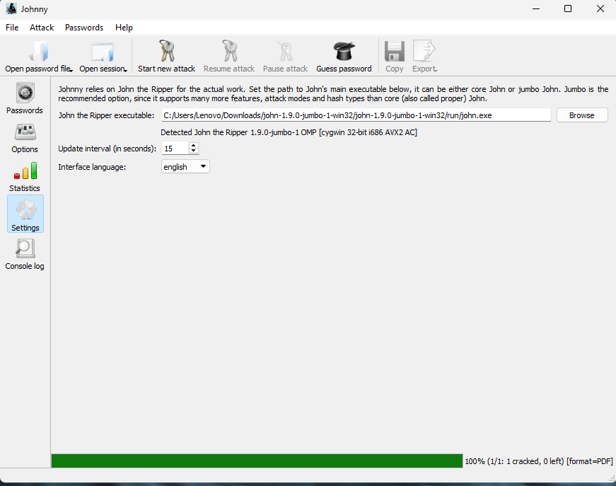
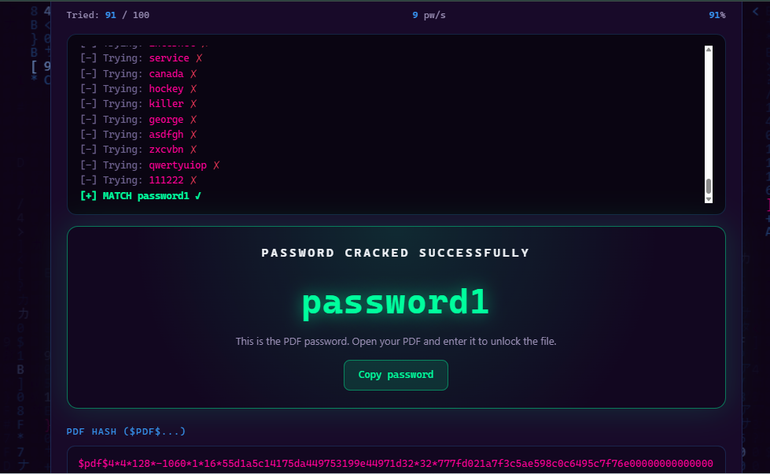

# NETWORKWALKS-B084-WK1-PM1-CYBERSECURITY-JTR

## 📌 Project Overview
This project focuses on password cracking using PASSWORD CRACKING WITH NETWORKWALKS TOOLS and John the Ripper (JTR).

The purpose of the project is to understand how password hashes work and explore how password-cracking tools can be used to recover passwords from available password hashes.

The activities are performed in a controlled laboratory environment using test password hashes, providing hands-on experience with password hash identification, password-cracking techniques, and understanding the importance of strong password protection.

---
## 🎯 Objectives
The main objectives of this project are to:
- Understand the fundamentals of password cracking.
- Explore and use PASSWORD CRACKING WITH NETWORKWALKS TOOLS.
- Install and configure John the Ripper (JTR).
- Understand password hashing and different hash formats.
- Perform password-cracking exercises using test password hashes.

---

## PASSWORD CRACKING WITH JTR 

1. Download John the Ripper from official website on your windows PC:

2. Starting password attack:

3. Password cracked sucessfully :

4. Password cracked successfully:
   

---
## PASSWORD CRACKING WITH NETWORKWALKS TOOLS

STEP 1
Download the encrypted PDF file (My Locked PDF1.pdf) to your laptop from the lab page:
https://networkwalks.com/project-task-lab-password-cracking-with-networkwalks-tools/

STEP 2
Open the Networkwalks Hash Calculator in your web browser:
https://networkwalks.com/hash-calculator/

STEP 3
Upload the locked PDF file to the Hash Calculator. The tool will read the file and give you the hash
value that starts with $pdf$...

STEP 4
Copy the full hash value.
Note: Copy the complete hash starting from $pdf$. Do not miss any part of it.

STEP 5
Open the Networkwalks Password Cracker in your web browser:
https://networkwalks.com/password-cracker/

STEP 6
Paste the hash value into the Password Cracker and start the attack. The tool will try different
passwords until it finds a match.

STEP 7
Wait for the tool to finish. 

STEP 8
Open the locked PDF file and enter the cracked password.

STEP 9
Your PDF file will open. 

---
## Issues Encountered and Solutions

1. Firewall Interference During ZIP File Extraction
- Issue: Some files were missing after extracting the ZIP file because the security protection was interfering with the extraction process.
- Solution: I investigated the issue and adjusted the security settings to allow the required files to be extracted successfully.
  
2. Incomplete ZIP File Extraction
- Issue: Some required files were not available in the extracted folder, preventing me from proceeding with the setup.
- Solution: I reviewed the extraction process and extracted the ZIP file again to ensure all required files were available.
  
3. John the Ripper Installation Issues
- Issue: Encountered difficulties getting John the Ripper installed and ready for use.
- Solution: Reviewed the installation requirements and followed the appropriate setup instructions to ensure the tool was properly configured.

---
## Lessons Learned
Through this project, I gained practical knowledge and a better understanding of password cracking techniques using NetworkWalks Tools and John the Ripper (JTR).

The key lessons learned include:
- Understanding Password Hashing: Learned how passwords are converted into hashes and why hashing is important for password storage.
  
- Using Cybersecurity Tools: Gained hands-on experience working with NetworkWalks Password Cracking Tools and John the Ripper (JTR).
  
- Command-Line Operations: Improved my ability to navigate directories, execute commands, and troubleshoot command-line errors.
  
- Password Hash Identification: Developed an understanding of different password hash formats and their importance when working with password-cracking tools.
  
- Troubleshooting Skills: Improved my problem-solving skills by resolving file extraction, firewall interference, and configuration issues.
  
- Password Security Awareness: Learned how weak passwords can be vulnerable and why strong, unique passwords are essential.
  
- Practical Experience: Gained confidence working with cybersecurity tools in a controlled lab environment.  

---
## Conclusion
This project provided valuable hands-on experience exploring password cracking using PASSWORD CRACKING WITH NETWORKWALKS TOOLS and John the Ripper (JTR).

Throughout the project, I gained a better understanding of password hashing, hash identification, and how password-cracking tools operate. I also developed practical command-line skills and improved my troubleshooting abilities by resolving challenges encountered during the setup and execution process.

Despite some initial difficulties, I was able to work through the issues and gain practical experience using the tools. Overall, this project strengthened my technical knowledge, problem-solving abilities, and understanding of password security, marking another important step in my cybersecurity learning journey.

---
## 📌 Security and Ethical Considerations

This environment is intended for authorized cybersecurity learning and testing.

Cybersecurity tools should only be used against systems and networks for which permission has been granted.

## 🖋️ ****Author****

Rishauna Gunning     

Cybersecurity Trainee B084
