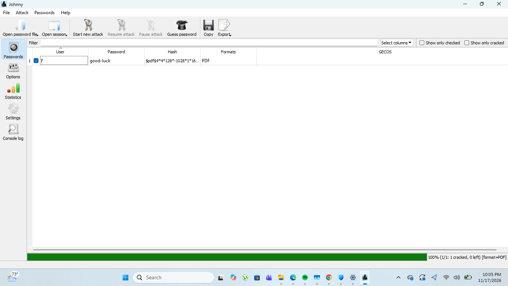
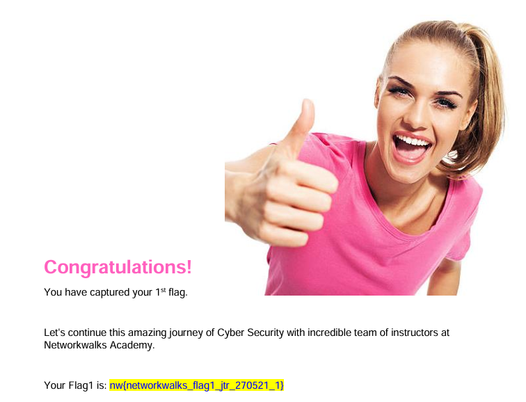

# NETWORKWALKS-B084-WK1-PM1-CYBERSECURITY-JTR

## 📌 Project Overview
This project focuses on password cracking using PASSWORD CRACKING WITH NETWORKWALKS TOOLS and John the Ripper (JTR).

The purpose of the project is to understand how password hashes work and explore how password-cracking tools can be used to recover passwords from available password hashes.

The activities are performed in a controlled laboratory environment using test password hashes, providing hands-on experience with password hash identification, password-cracking techniques, and understanding the importance of strong password protection.

---
## 🎯 Objectives
The main objectives of this project are to:
- Understand the fundamentals of password cracking.
- Explore and use PASSWORD CRACKING WITH NETWORKWALKS TOOLS.
- Install and configure John the Ripper (JTR).
- Understand password hashing and different hash formats.
- Perform password-cracking exercises using test password hashes.

---

## PASSWORD CRACKING WITH JTR 

1. Download John the Ripper from official website on your windows PC:

2. Starting password attack:

3. Password cracked sucessfully :

4. Password cracked successfully:

---
## PASSWORD CRACKING WITH NETWORKWALKS TOOLS

STEP 1
Download the encrypted PDF file (My Locked PDF1.pdf) to your laptop from the lab page:
https://networkwalks.com/project-task-lab-password-cracking-with-networkwalks-tools/

STEP 2
Open the Networkwalks Hash Calculator in your web browser:
https://networkwalks.com/hash-calculator/

STEP 3
Upload the locked PDF file to the Hash Calculator. The tool will read the file and give you the hash
value that starts with $pdf$...

STEP 4
Copy the full hash value.
Note: Copy the complete hash starting from $pdf$. Do not miss any part of it.

STEP 5
Open the Networkwalks Password Cracker in your web browser:
https://networkwalks.com/password-cracker/

STEP 6
Paste the hash value into the Password Cracker and start the attack. The tool will try different
passwords until it finds a match.

STEP 7
Wait for the tool to finish. 

STEP 8
Open the locked PDF file and enter the cracked password.

STEP 9
Your PDF file will open. 

---
